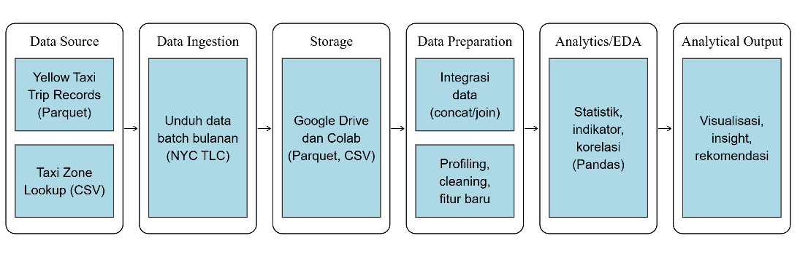
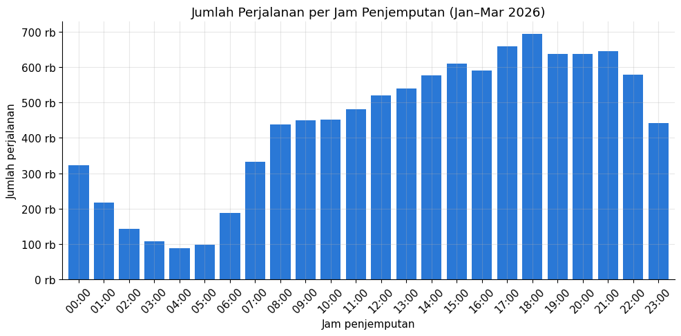
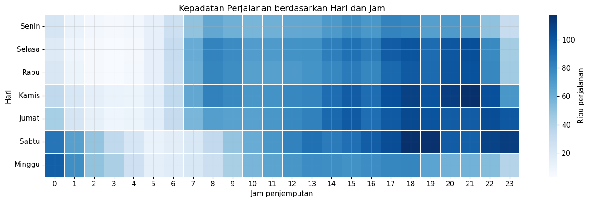
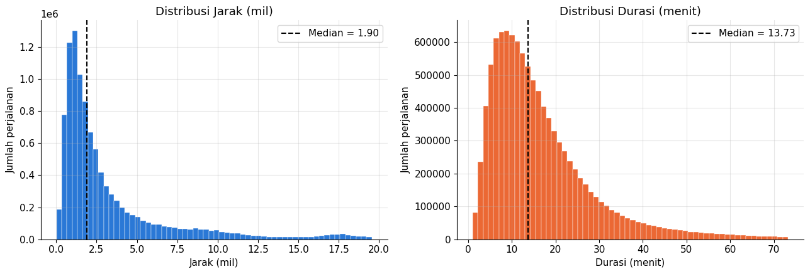
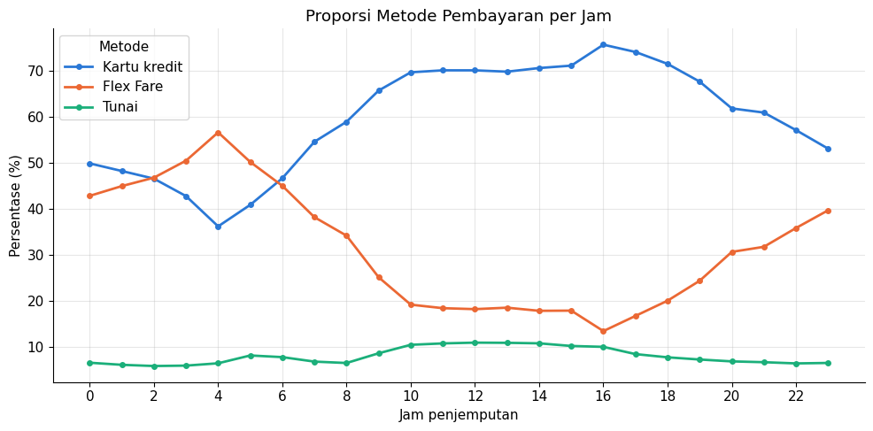
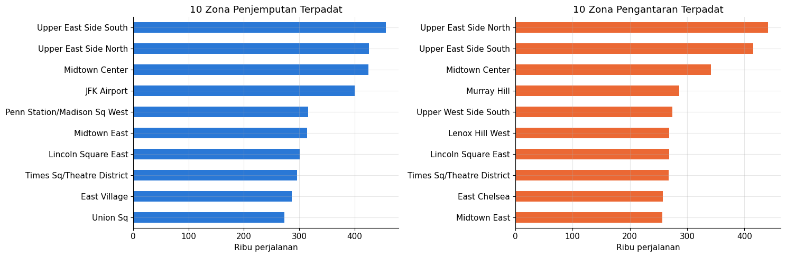
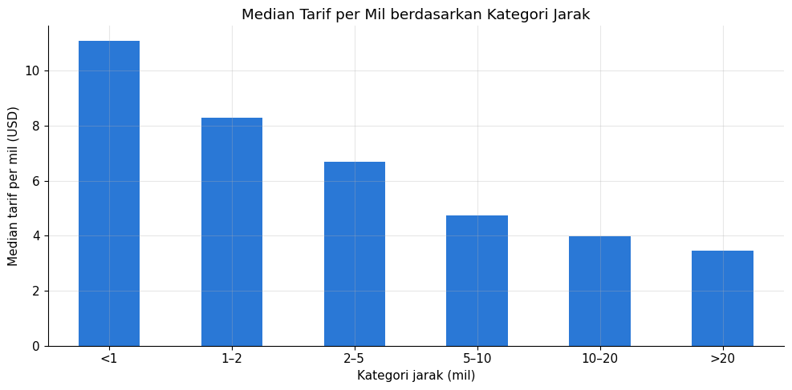
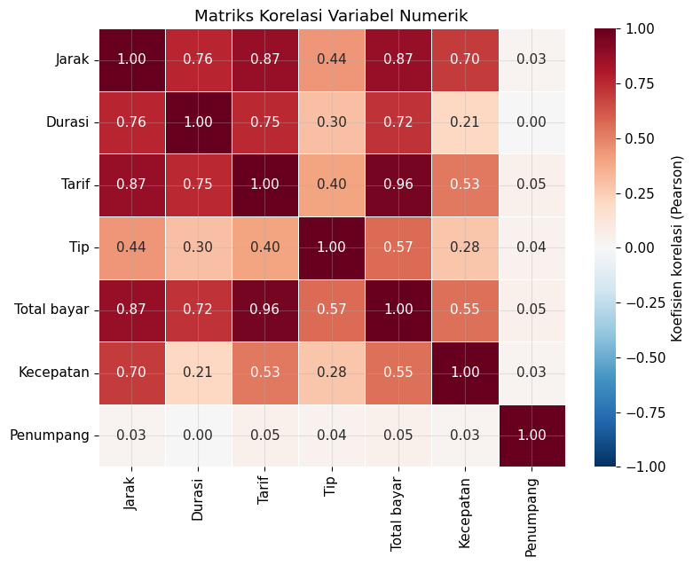

<h1 align="center">🚕 Analisis Perjalanan Taksi Kuning New York City</h1>
<p align="center"><b>Menggali 11 juta+ data perjalanan untuk menemukan kapan, di mana, dan bagaimana warga NYC naik taksi</b></p>

<p align="center">
  
  
  
  
  
</p>

<p align="center">
  📓 <a href="https://colab.research.google.com/drive/1yHrRVo3FsC11HKq3kQjsvdYUeEy8eTBy?usp=sharing"><b>Buka Notebook di Google Colab</b></a> &nbsp;•&nbsp;
  📄 <a href="./UTS_BDA_825240012_Callysta%20Dethan.pdf"><b>Baca Laporan Lengkap (PDF)</b></a>
</p>

---

## 🎯 Tentang Proyek

Setiap hari, lebih dari **123 ribu perjalanan** taksi kuning tercatat di New York City. Data sebesar ini terlalu besar untuk dibuka di Excel, tapi menyimpan cerita menarik tentang pola mobilitas sebuah kota.

Dalam proyek ini, saya berperan sebagai **tim data analytics** untuk manajemen transportasi kota: mengolah **11.077.206 data perjalanan** mentah dari NYC Taxi & Limousine Commission (TLC) menjadi insight dan rekomendasi yang bisa langsung dipakai untuk keputusan operasional.

> 🎓 Dikerjakan untuk mata kuliah *Big Data Analytics*, Program Studi Sistem Informasi, Universitas Tarumanagara (2026).

---

## ⚡ Temuan Utama dalam 30 Detik

| | Temuan |
|---|---|
| ⏰ | **Jam 18:00 adalah jam tersibuk** dengan 693.915 perjalanan, sekitar **7,8x lipat** dibanding jam 04:00 |
| 📍 | **85,84%** penjemputan terjadi di Manhattan, dan Bandara JFK masuk **peringkat ke-4** zona tersibuk |
| 🧍 | Taksi kuning adalah transportasi perorangan jarak dekat: median **1,90 mil / 13,7 menit**, dan **83,21%** hanya membawa satu penumpang |
| 💳 | Kartu kredit paling populer (**64,30%**), tapi di Brooklyn (**65,3%**) dan Staten Island (**81,0%**) justru **Flex Fare** berbasis aplikasi yang mendominasi |
| 💲 | Perjalanan pendek paling mahal per mil: **$11,07/mil** untuk rute < 1 mil, dibanding **$3,47/mil** untuk rute > 20 mil |

---

## ❓ Pertanyaan Bisnis yang Dijawab

| Kode | Pertanyaan |
|---|---|
| **BQ1** | Pada jam dan hari apa permintaan taksi paling tinggi? |
| **BQ2** | Seperti apa karakteristik perjalanan berdasarkan jarak, durasi, dan jumlah penumpang? |
| **BQ3** | Metode pembayaran apa yang paling sering dipakai, dan apakah berbeda menurut waktu dan lokasi? |
| **BQ4** | Zona dan borough mana yang paling ramai untuk penjemputan dan pengantaran? |
| **BQ5** | Bagaimana hubungan tarif dan tip dengan jarak, waktu, dan metode pembayaran? |

---

## 🗂️ Dataset

| Sumber | Format | Ukuran |
|---|---|---|
| [NYC TLC Trip Record Data](https://www.nyc.gov/site/tlc/about/tlc-trip-record-data.page): Yellow Taxi, Januari–Maret 2026 | Parquet (±182 MB) | 11.077.206 baris × 20 atribut |
| Taxi Zone Lookup | CSV | 265 zona |

💡 Jumlah datanya melebihi batas Excel (1.048.576 baris), sehingga pengolahan dilakukan dengan **Python dan Pandas di Google Colab**. Data mentah tidak disertakan di repo ini dan bisa diunduh langsung dari situs TLC.

---

## ⚙️ Alur Kerja



**1️⃣ Integrasi data:** menggabungkan 3 file Parquet bulanan, lalu melakukan join dengan Taxi Zone Lookup berdasarkan `LocationID` untuk mendapatkan nama zona dan borough.

**2️⃣ Data profiling:** menemukan berbagai "keanehan" dalam data mentah, di antaranya:
- 3.057.123 nilai kosong yang ternyata **sistematis**, karena semuanya berasal dari perjalanan Flex Fare
- 134.801 perjalanan dengan durasi nol atau negatif
- 86.908 tarif bernilai negatif dan 370.198 perjalanan berjarak 0 mil
- Outlier ekstrem, termasuk satu perjalanan yang tercatat sejauh **328.522 mil** 😅

**3️⃣ Data cleaning 2 tahap:**

| | Jumlah record | % |
|---|---|---|
| Sebelum cleaning | 11.077.206 | 100,00 |
| Dihapus | 624.413 | 5,64 |
| **Setelah cleaning** | **10.452.793** | **94,36** |

Perjalanan Flex Fare **tetap dipertahankan dan diberi penanda**, bukan dihapus. Data waktu, lokasi, jarak, dan tarifnya lengkap, sehingga menghapusnya berarti membuang 27,6% data yang sebenarnya berguna.

**4️⃣ Feature engineering (7 fitur baru):** jam penjemputan, hari, penanda weekday/weekend, durasi perjalanan, kecepatan rata-rata, tarif per mil, dan persentase tip.

**5️⃣ Exploratory Data Analysis:** statistik deskriptif, 13 visualisasi, dan analisis korelasi Pearson.

---

## 📊 Sorotan Analisis

### ⏰ BQ1 · Kapan taksi paling dicari?



Permintaan terus naik sepanjang hari dan memuncak pada **pukul 18:00**, saat jam pulang kerja. Waktu terpadat ada di **Kamis hingga Sabtu malam (18:00–21:00)**. Sabtu mencatat rata-rata harian tertinggi (132.371 perjalanan), dan akhir pekan sedikit lebih ramai dibanding hari kerja (118.052 vs 115.366 perjalanan per hari) berkat lonjakan perjalanan di dini hari.

### 🧍 BQ2 · Seperti apa perjalanan pada umumnya?


Distribusi jarak dan durasi menceng ke kanan, dengan median **1,90 mil** dan **13,73 menit**. Median kecepatan hanya **9,30 mil/jam**, gambaran nyata padatnya lalu lintas New York.

### 💳 BQ3 · Bagaimana penumpang membayar?


| Borough | Kartu kredit | Flex Fare | Tunai |
|---|---|---|---|
| Manhattan | 65,9% | 25,3% | 8,1% |
| Queens | 64,8% | 19,1% | **14,4%** |
| Brooklyn | 33,3% | **65,3%** | 1,3% |
| Bronx | 51,3% | 47,1% | 1,5% |
| Staten Island | 7,1% | **81,0%** | 11,7% |

Kartu kredit menguasai jam aktif siang hingga sore (sampai ±75%), sedangkan Flex Fare justru melonjak di atas 55% pada pukul 04:00–05:00.

### 📍 BQ4 · Di mana aktivitas paling padat?


**Upper East Side South** menjadi zona tersibuk dengan ±457 ribu penjemputan. Queens mencatat perjalanan terjauh (median 10,02 mil dengan tarif $44,30), didorong oleh lalu lintas dari dan ke bandara.

### 💲 BQ5 · Apa yang memengaruhi tarif dan tip?



Tarif berkorelasi sangat kuat dengan jarak (**r = 0,87**) dan kuat dengan durasi (**r = 0,75**). Terlihat juga konsentrasi tarif di angka **$70**, yaitu tarif tetap rute JFK–Manhattan. Rata-rata tip pembayaran kartu kredit mencapai **$4,12**, sementara tip tunai tidak tercatat dalam data.

---

## 💡 Rekomendasi

| Rekomendasi | Tindakan konkret | Dasar |
|---|---|---|
| 🚖 **Pengaturan armada dinamis** | Tambah armada di Manhattan pukul 17:00–19:00 pada hari kerja dan 00:00–02:00 pada akhir pekan; kurangi pada 03:00–05:00 | BQ1 |
| ✈️ **Optimalisasi layanan Bandara JFK** | Sediakan zona penjemputan khusus dan antrean taksi yang tertata | BQ4 |
| 📱 **Perluas Flex Fare di luar Manhattan** | Kerja sama dengan penyedia aplikasi untuk memperluas jangkauan di Brooklyn, Bronx, dan Staten Island | BQ3 |
| 🔋 **Evaluasi armada dan tarif rute pendek** | Pertimbangkan kendaraan kompak atau listrik untuk perjalanan pendek perorangan, serta tinjau ulang tarif dasar | BQ2, BQ5 |

---

## ⚠️ Keterbatasan

- Tip pada pembayaran tunai tidak tercatat, sehingga analisis tip hanya mencakup transaksi kartu kredit.
- Perjalanan Flex Fare (27,6%) tidak memiliki data jumlah penumpang dan biaya tambahan.
- Periode tiga bulan belum bisa menggambarkan pola musiman sepanjang tahun.
- Analisis bersifat deskriptif dan korelasional, sehingga belum membuktikan hubungan sebab-akibat.

---

## 📁 Struktur Repository

```
├── *.png        # Visualisasi hasil analisis
├── *.ipynb      # Notebook Google Colab
├── *.pdf        # Laporan lengkap
└── README.md
```

---

## 👩‍💻 Dibuat oleh

**Callysta Elysia Theona Dethan**  
Mahasiswi Sistem Informasi, Universitas Tarumanagara

<a href="https://www.linkedin.com/in/callysta-dethan-a3112225b"></a>
<a href="https://github.com/Callysta27"></a>

⭐ *Kalau proyek ini bermanfaat atau menarik, jangan ragu untuk memberi bintang!*
